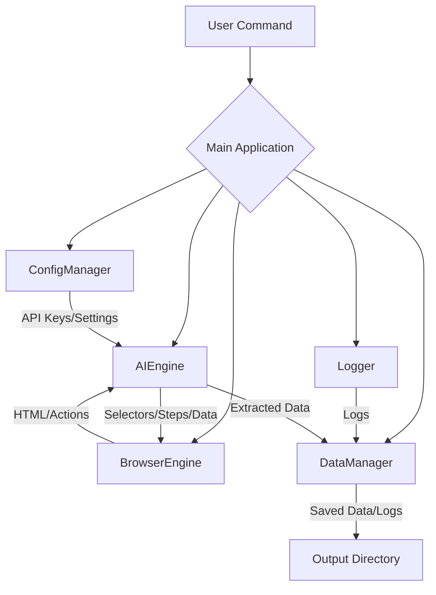

# AI-based Automation Tool (Mistral)

This is an AI-powered browser automation tool designed with a modular architecture, leveraging Mistral for intelligent element detection, step generation, and data extraction.

## Table of Contents
- [Features](#features)
- [Architecture](#architecture)
- [Installation](#installation)
- [Configuration](#configuration)
- [Usage](#usage)
- [Project Structure](#project-structure)
- [Testing](#testing)
- [Contributing](#contributing)
- [License](#license)

## Features
- **Modular Architecture**: Separates browser automation, AI engine, and data management.
- **AI-Powered Element Detection**: Uses Mistral LLM to dynamically identify elements on web pages.
- **AI-Driven Automation Steps**: Generates automation sequences based on high-level goals.
- **Flexible Data Extraction**: Extracts structured data from HTML content.
- **Extensible Output**: Saves extracted data in JSON and CSV formats.
- **Secure Configuration**: Utilizes environment variables for sensitive data like API keys.
- **Comprehensive Logging**: Detailed logging for every automation step.

## Architecture

The tool is designed with a clear separation of concerns:
- **Browser Automation Engine**: Handles interactions with web browsers (e.g., navigation, typing, clicking, HTML retrieval) using Playwright.
- **AI Engine**: Interfaces with the Mistral LLM for intelligent tasks like page analysis, step generation, and data extraction.
- **Data Management**: Manages saving extracted data and logs in structured formats.
- **Configuration Management**: Handles loading environment variables and application settings.
- **Logging**: Provides a centralized logging mechanism for the application.



## Installation

1.  **Clone the repository**:
    ```bash
    git clone https://github.com/your-repo/ai-automation-tool.git
    cd ai-automation-tool
    ```

2.  **Install Python dependencies**:
    ```bash
    pip install -r requirements.txt
    ```

3.  **Install Playwright browsers**:
    ```bash
    playwright install
    ```

    *Note: If you encounter missing dependency errors during `playwright install`, you might need to install system-level dependencies. Refer to Playwright's official documentation for your specific operating system.*

## Configuration

This tool uses environment variables for sensitive information, primarily your Mistral API Key.

1.  **Create a `.env` file**:
    Copy the example environment file:
    ```bash
    cp .env.example .env
    ```

2.  **Edit the `.env` file**:
    Open the newly created `.env` file and replace `your_mistral_api_key_here` with your actual Mistral API Key.
    ```dotenv
    MISTRAL_API_KEY=your_mistral_api_key_here
    MISTRAL_API_BASE=https://api.mistral.ai/v1
    MISTRAL_MODEL=mistral-tiny
    ```

    *Keep your `.env` file secure and do not commit it to version control.*

## Usage

To run the main application example:

```bash
python main.py
```

This will launch a headless browser, navigate to Google, use AI to find the search bar, type a query, and save some sample data. Check the `output/` and `logs/` directories for results.

### Running Tests

To run the unit tests:

```bash
pytest
```

## Project Structure

```
ai_automation_tool/
├── main.py                 # Main entry point of the application
├── requirements.txt        # Python dependencies
├── .env.example            # Example environment variables file
├── .gitignore              # Files/directories to ignore in Git
├── library/                # Core modules and classes
│   ├── __init__.py
│   ├── ai_engine.py        # AI Engine for Mistral API integration
│   ├── browser_engine.py   # Browser automation using Playwright
│   ├── config_manager.py   # Handles configuration and environment variables
│   ├── data_manager.py     # Manages data saving (JSON, CSV) and logging
│   └── logger.py           # Centralized logging utility
├── scripts/                # Example scripts and utilities
│   ├── test_ai_engine.py
│   ├── test_browser_engine.py
│   └── test_data_manager.py
├── config/                 # Configuration files (if any, currently via .env)
├── output/                 # Directory for extracted data and logs
├── tests/                  # Unit and integration tests
│   ├── __init__.py
│   ├── conftest.py
│   ├── test_ai_engine.py
│   ├── test_browser_engine.py
│   └── test_data_manager.py
└── docs/                   # Documentation files
    ├── workflow_diagram.md
    ├── prompt_templates.md
    ├── dynamic_element_detection.md
    ├── feedback_error_handling.md
    ├── output_data_format.md
    └── security_plan.md
```

## Contributing

Contributions are welcome! Please feel free to submit a Pull Request.

## License

This project is licensed under the MIT License - see the LICENSE file for details.


